# Crew Health Monitor

Health monitoring for a crew that cannot call a doctor. Built for the NASA Space Apps Challenge 2026, "Create Health Monitoring Software for Astronauts on Space Missions".

> **Read this first.** Every person and every reading in this app is simulated. It is a concept demonstrator for a hackathon, not a medical device, and it has not been clinically validated.

**Live demo: https://crew-health-monitor.vercel.app** (every demo account uses PIN `2026`). The live link is a reduced version; see [Live demo versus local](#live-demo-versus-local).

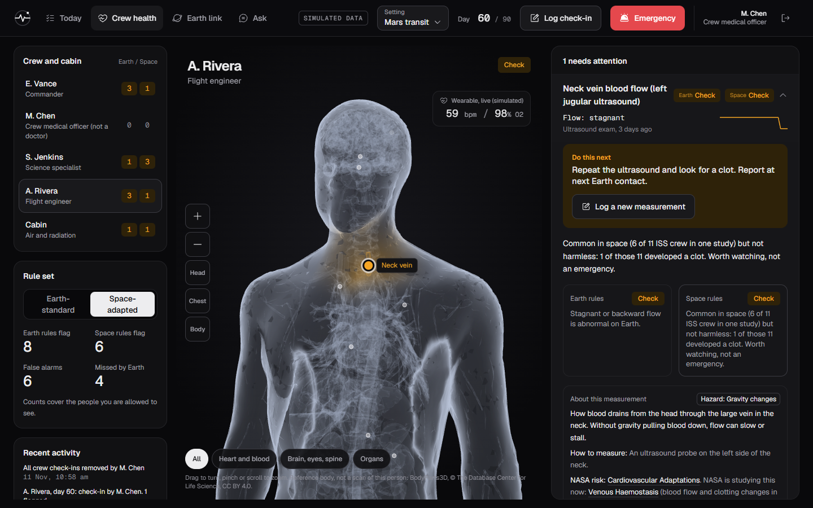

## The problem

On the way to Mars, a question to Earth and its answer can take more than 40 minutes. The crew has no doctor on board. And the body changes in space, so the normal ranges printed on an Earth lab report stop being reliable:

- Hematocrit rises about 10 to 12% in flight. An Earth rule calls that dehydration. It is expected.
- Cabin CO2 that passes Earth workplace limits still gives crews headaches. An Earth rule misses it.
- Passing 1.6 litres of urine a day is normal on Earth. In space, where bones shed calcium into the urine, it is a kidney stone risk.

## The idea

Crew Health Monitor checks the same data with two rule sets and shows both verdicts side by side.

| | Earth-standard rules | Space-adapted rules |
|---|---|---|
| Normal spaceflight change | False alarm | Explained as expected |
| Concern that only matters in space | Missed | Flagged, with what to do next |
| Where the rule comes from | Lab reference range | A published spaceflight source, linked on screen |

Any threshold without a published source is labelled "Demo parameter" on screen. Nothing unconfirmed is shown as fact.

How this maps to the challenge text, line by line, is in [CHALLENGE.md](CHALLENGE.md).

## NASA and partner resources used

The challenge lists these resources. This is where each one shows up in the app.

| Resource | How we use it |
|---|---|
| [NASA: five hazards of human spaceflight](https://www.nasa.gov/hrp/hazards/) | Every signal is tagged with its hazard |
| [NASA: risks of human spaceflight](https://www.nasa.gov/hrp/risks/) | Every signal links to its official NASA risk page (for example SANS, bone changes, food and nutrition, immune responses, sleep, behavioral changes, cardiovascular adaptations, radiation-induced cancers). Facts taken from those pages: bone loss of 1 to 1.5% a month, and about 70 percent of station astronauts with some swelling at the back of the eye |
| [NASA: ongoing research](https://www.nasa.gov/hrp/ongoing-hrp-research/) | Signals name the current NASA study on the same question: Venous Haemostasis (neck vein), Thigh Cuff (eyes), ARCHeR (sleep), Immune Biomarkers (white cells), Zero T2 (exercise) |
| [Canadian Space Agency: monitoring radiation](https://www.asc-csa.gc.ca/eng/news/articles/2026/2026-02-26-monitoring-radiation-astronaut-health.asp) | The radiation explanation notes that neutrons make up about 30% of the dose on the station |
| [Canadian Space Agency: why science in space](https://www.asc-csa.gc.ca/eng/iss/science/why-do-we-conduct-science-experiments-in-space.asp) | The mission settings follow its list of deep-space challenges: more weightlessness, more radiation, longer isolation, longer delays, less help from Earth |

These pages give no numeric thresholds, so they do not replace our "Demo parameter" labels. NASA risks with no signal in this app: balance and coordination, teamwork, low oxygen, decompression sickness, spacewalk injury, and microbes. Kidney stones are a signal here but are not on NASA's list of 17 risks.

## Why rules and not a prediction model

This is a deliberate choice, not a missing feature.

- **No data to learn from.** Day-by-day in-flight astronaut vitals are not public. A model trained on invented data would only learn our invention.
- **It has to run on board.** A spacecraft cannot wait 40 minutes for a cloud service. The rules run in the browser with no connection.
- **A crew far from help must see why.** Every flag shows its reason and its source, so the crew and the flight surgeon can check it. A model's score cannot be audited the same way.

## Features

### Crew health

A 3D body built from real anatomical models. The part of the body behind each flagged signal glows, and opening a signal moves the camera to it. Zoom with the scroll wheel or by pinching on a touch screen.

Each signal shows what to do next first, then the reason, then the Earth and space verdicts, then a plain explanation of the measurement (what it is, why it matters in space, how to take it), then where the reading came from and how old it is.

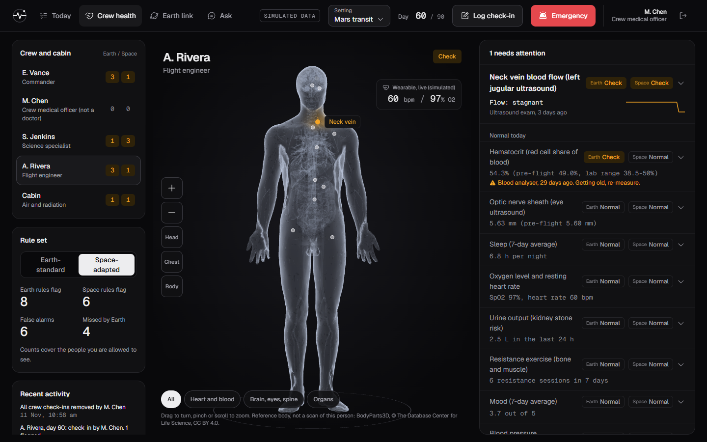

### Signals

Thirteen crew signals and two cabin signals, each tagged with one of NASA's five hazards of spaceflight:

| Signal | Earth and space rules differ? | Rule source |
|---|---|---|
| Hematocrit | Yes | Published |
| Optic nerve sheath (eye ultrasound) | Yes | Published, change threshold is a demo parameter |
| Neck vein blood flow | Explanation differs | Published |
| Headache with cabin CO2 | Yes | Published |
| Urine output (kidney stones) | Yes | Published, to be re-checked |
| White blood cells and lymphocytes (immune) | Yes | Lab ranges from NASA OSD-569; in-flight rise published; action level is a demo parameter |
| Vitamin D (nutrition) | Yes | NASA protocol and flight studies, to be re-checked |
| Resistance exercise (bone loss) | Yes | Bone loss published, weekly cut-off is a demo parameter |
| Cabin CO2 | Yes | Published |
| Radiation dose | Yes | Published |
| Sleep | No | Demo parameter |
| Oxygen level and heart rate | No | Demo parameter |
| Mood | No | Demo parameter |
| Body mass (food intake) | No | Demo parameter |
| Blood pressure, temperature, blood sugar | No | Demo parameter (ordinary Earth limits) |

### Trends since launch

A larger chart of any three signals over the whole mission so far, against the crew member's pre-flight value.

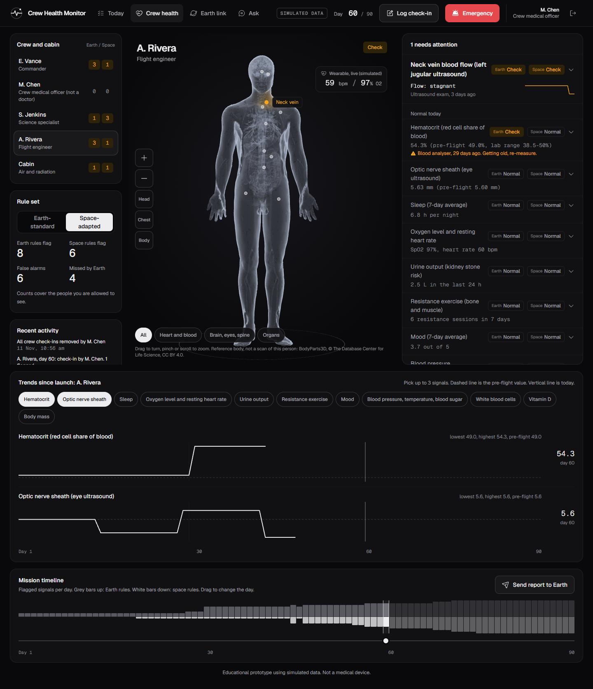

### Image attachment

A crew member can attach a photo or ultrasound image to a check-in. It is shrunk in the browser, stored with the check-in and shown with the eye signal. The app does not analyse the image and says so on screen. It is not yet sent to Earth with the report.

### Mission setting

Choose space station, Moon surface or Mars transit. The setting changes the signal delay to Earth, how fast radiation dose builds up, and, on the Moon, how strong the fluid shift toward the head is.

| Setting | One-way message delay | Radiation (dose equivalent) | Gravity |
|---|---|---|---|
| Space station | under 1 second (NASA) | 0.73 mSv a day (three peer-reviewed ISS measurements, 0.6 to 0.8) | Weightless |
| Moon surface | 1.3 seconds (distance divided by light speed) | 1.37 mSv a day (Chang'E-4, the only surface measurement so far) | One sixth of Earth |
| Mars transit | 4 to 22 minutes, by mission day | 1.8 mSv a day (Curiosity, measured in cruise) | Weightless |

**Moon gravity.** The space rules come from weightless missions. A parabolic-flight study found the neck vein widens step by step as gravity falls, but it only went down to a quarter of Earth gravity, and nobody has measured a long stay on the Moon. So in the Moon setting the simulation applies 60% of the weightless fluid shift, labelled as a demo parameter, and each gravity-related signal carries a note saying its rule was written for weightlessness.

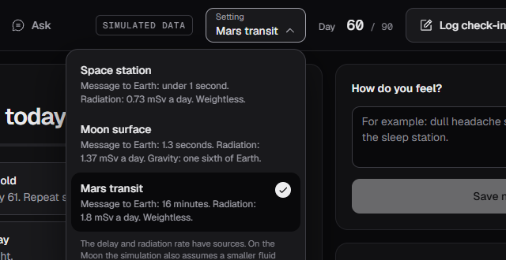

### Body systems

Switch between all systems, heart and blood, brain eyes and spine, and organs.

| Heart and blood | Female reference body |
|---|---|
| 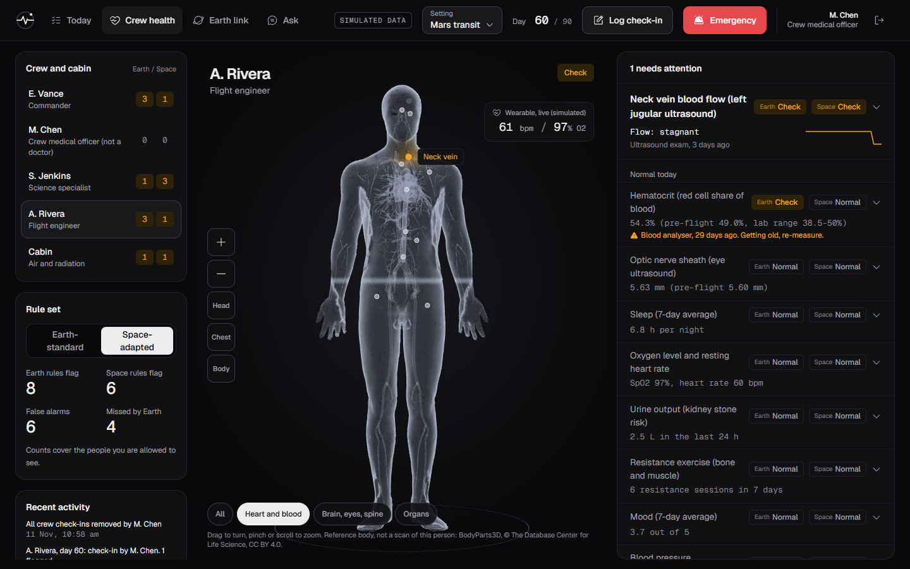 | 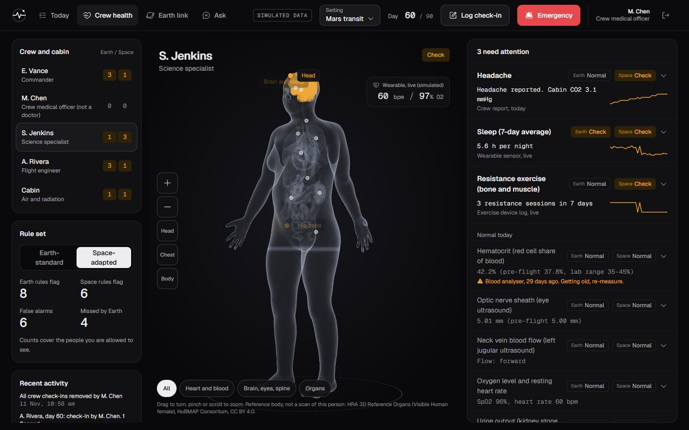 |

### Today

What the signed-in crew member needs to do today: exams that are due or getting old, signals to re-check, a note in their own words, and messages from Earth. The medical officer also gets a view of the whole crew.

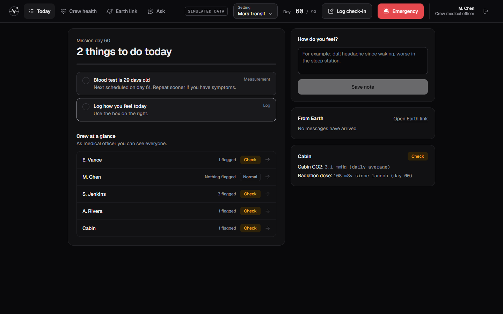

### Earth link

Messages and health reports travel with the signal delay for the mission day, with a countdown. The demo plays one minute of delay as one second.

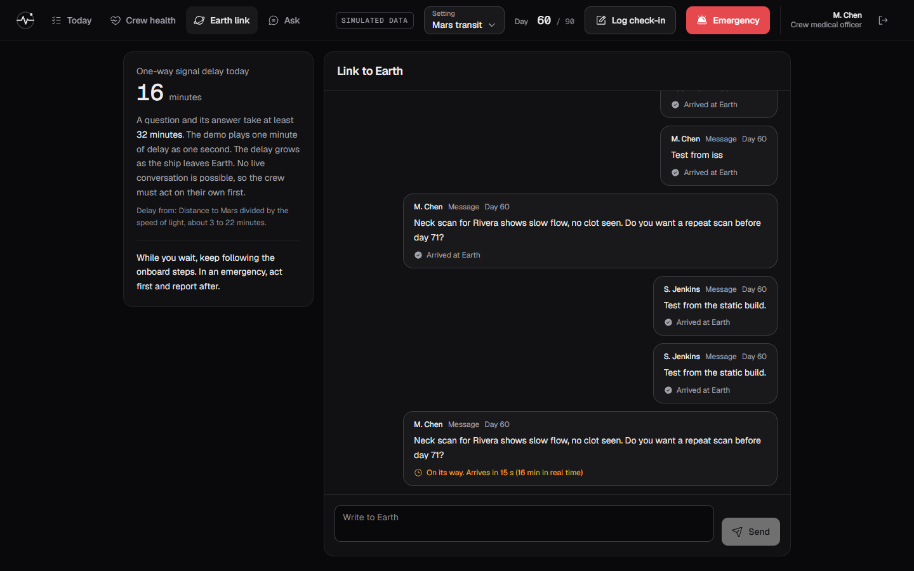

### Ask the handbook

An assistant with no AI model and no connection. It answers only from today's readings, the rules and the emergency steps, shows the source, and says "I don't have that" when it does not know. It cannot invent medical advice.

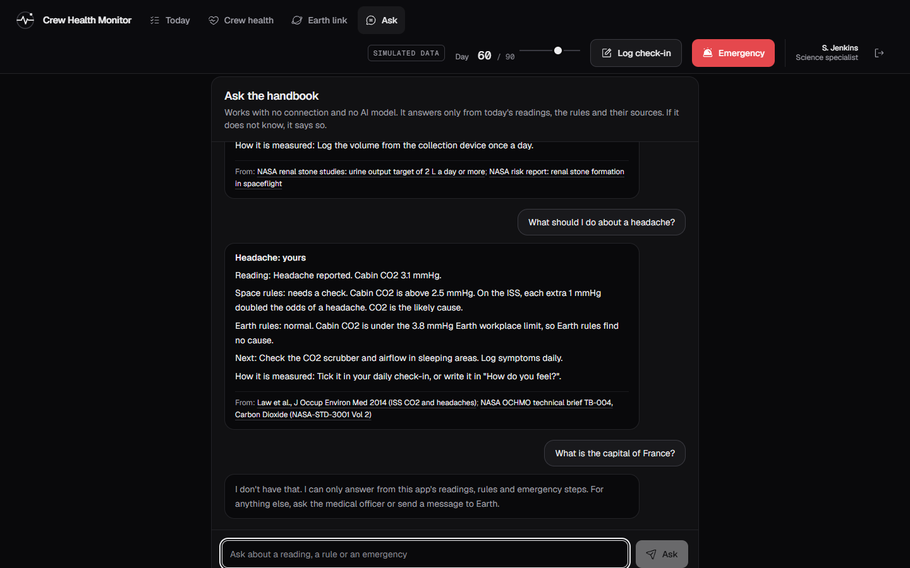

### Emergency

Step-by-step walkthroughs with large controls. The screen points to the scenario the sensors suggest. Every step is marked as coming from a published source or as demo wording. The run is timed, saved, and sent to Earth.

| Choose the scenario | Follow the steps |
|---|---|
| 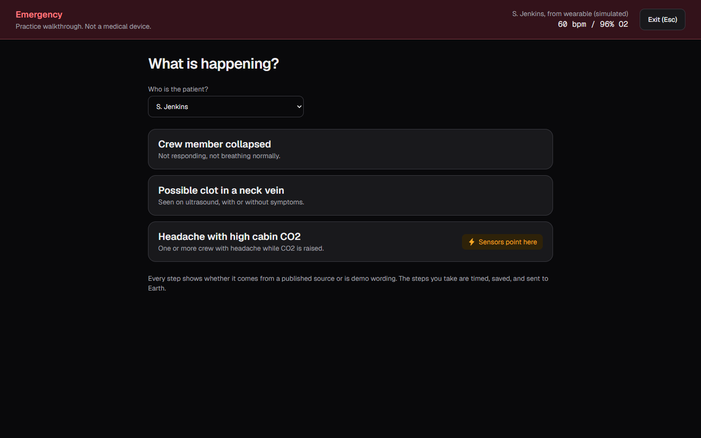 | 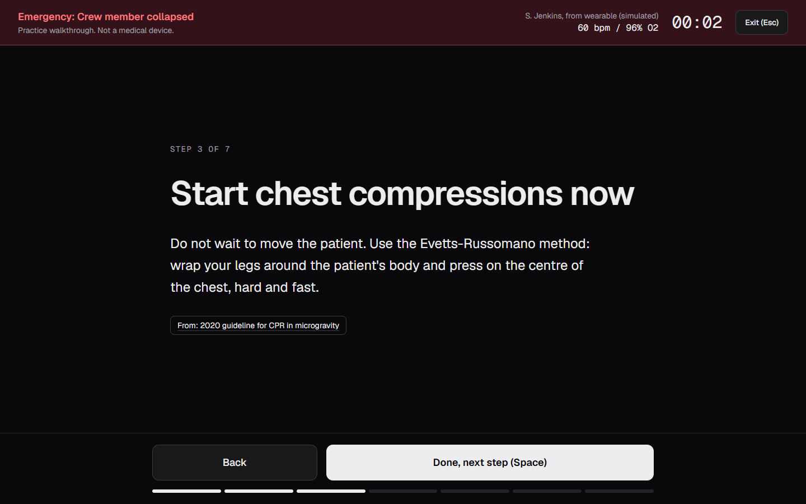 |

### Sign-in and privacy

| Role | Sees |
|---|---|
| Crew member | Their own health data |
| Crew medical officer | Every crew member |
| Flight surgeon on Earth | Only what the crew sent, after the delay |

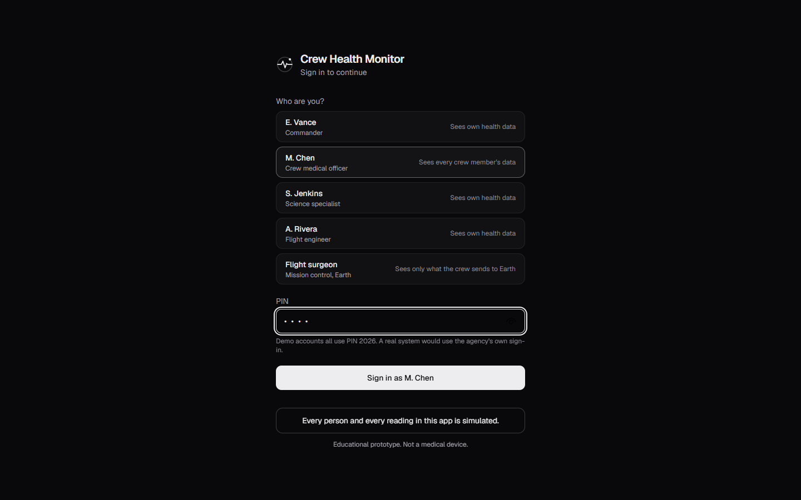

## Live demo versus local

The public link and a local run are not the same thing. Please do not judge the privacy claims from the public link.

| | Local run (`npm run dev`) | Live demo link |
|---|---|---|
| Server and database | Yes: Node API with SQLite | None. The app answers its own calls inside the browser |
| Roles and privacy | Enforced by the server | For show only |
| Earth link | Works between any browsers using the server | Works between tabs of one browser |
| Where data is kept | Database file on the machine | That browser's storage |

The live demo shows a banner saying this.

## Run it

Needs Node 24 or newer. No other services.

```bash
npm install
npm run dev
```

Open http://localhost:5173. Every demo account uses PIN `2026`. To see the Earth side, sign in as "Flight surgeon" in a second browser tab.

```bash
npm test
```

A three-minute walkthrough for presenting it is in [DEMO_SCRIPT.md](DEMO_SCRIPT.md).

## How it is built

| Part | Where |
|---|---|
| Rules, as tested pure functions | `src/triage.ts` |
| Source for every threshold | `src/data/sources.ts`, notes in `RESEARCH_LOG.md` |
| Plain-language guide to each measurement | `src/data/signalGuide.ts` |
| Simulated crew and device feed | `src/data/simulatedCrew.ts`, `src/model.ts` |
| API and SQLite database | `server/index.ts` |
| In-browser stand-in for the server | `src/localBackend.ts` |
| 3D body | `src/BodyScan.tsx`, `src/body/anatomy.ts`, `public/anatomy/` |
| Screens | `src/Today.tsx`, `src/Overview.tsx`, `src/EarthLink.tsx`, `src/Ask.tsx`, `src/Emergency.tsx` |
| Offline assistant | `src/handbook.ts` |

Stack: React, TypeScript, Vite, Tailwind, Motion, three.js. The backend uses only what ships with Node (its built-in web server and SQLite), and imports the same rule file as the screens, so there is one copy of the rules.

First load: the 3D view and its 13 MB model file load only when the Crew health tab is opened.

## What is real and what is simulated

| Real | Simulated |
|---|---|
| The published sources behind each rule | The crew and their accounts |
| Lab ranges and pre-flight blood values (NASA OSDR dataset OSD-569) | Every day-by-day reading |
| Radiation rate measured on the way to Mars | The device feed and its schedules |
| The organ and body models | Emergency steps marked "demo only" |

## What it would take to be real

This is a prototype. It is not deployable, and we do not claim it is. A real system would need:

- Integration with real devices instead of a simulated feed.
- The agency's own identity system. Here every demo account shares one PIN.
- Encryption of data at rest and in transit.
- Clinical validation of every threshold, including the ones that have a published source.
- Peripheral nerves and a matched female vessel model, which the free anatomical datasets do not include.
- Images sent to Earth with the report, and any reading of them. Today an image is only stored and shown.
- Measured data for long stays in Moon gravity. The 60% fluid shift is an assumption, and bone loss, mission length and crew routines do not change with the setting.

## Optional: Gemini rewording

The Ask tab works with no AI model. If you want friendlier wording, it can pass the handbook answer to Gemini to be reworded. Gemini only rewrites text the handbook already chose, and the original text stays visible under it. This needs internet, so it is a demo extra, not something for a spacecraft.

- Locally: copy `.env.example` to `.env` and put your key after `GEMINI_API_KEY=`.
- On Vercel: Project, Settings, Environment Variables, add `GEMINI_API_KEY`, then redeploy.

The key stays on the server (`api/reword.js`). It is never sent to the browser and `.env` is not committed.

## Credits

- Male body, organs and vessels: BodyParts3D, © The Database Center for Life Science, licensed under CC Attribution 4.0 International. Simplified for the web. The left neck vein is the right one mirrored.
- Female body, organs and vessels: HRA 3D Reference Organs (Visible Human female), HuBMAP Consortium, CC BY 4.0. Simplified for the web.
- Blood count data: NASA Open Science Data Repository, OSD-569.
- Type: Geist. Icons: Phosphor.

The mark in the header is our own. It is not a NASA logo.
